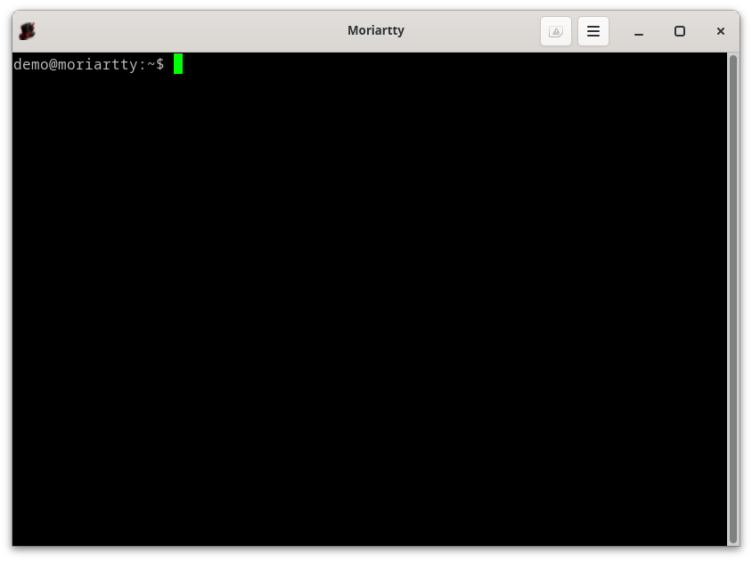
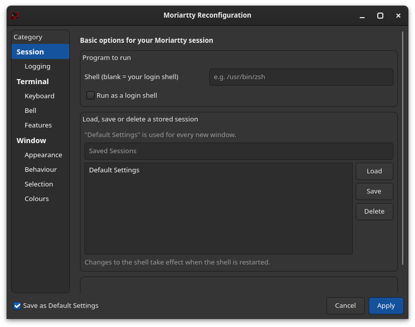

# Moriartty

A fast, private-by-default terminal emulator for Linux, inspired by PuTTY's
`pterm`. Written in Rust with GTK 4 + VTE.





## Why Moriartty

* **Safe by default, not by configuration.** What you paste is filtered,
  and pastes that could run something hidden are shown to you first.
  Programs can't write to your clipboard, read your window title or
  "type" answers back into your shell. Links never open on their own, and
  addresses that could fool you are refused or spelled out. You don't have
  to find a setting for any of this.
* **Nothing leaves your machine.** No network access, no telemetry, no
  update checks. Opening a link you Ctrl+clicked is the only thing that
  ever goes out.
* **Your secrets stay out of the clipboard.** Selecting text fills only the
  PRIMARY selection, so clipboard managers don't keep the passwords and
  tokens you select. Copying a large scrollback asks first, and a red dot
  shows when a tab is being logged.
* **Saved sessions that do something.** A saved session can run a command,
  like `ssh admin@prod.example.com` or `toolbox enter dev`, with its own
  colours and title (red for production, if you like). Open one from the ▾
  next to the tabs, with Ctrl+Shift+S, or with `-load`.
* **Shell integration.** With a one-line addition to your bash, zsh or fish
  startup file, Ctrl+Shift+Up / Ctrl+Shift+Down jump between prompts, and a
  long build that ends in a background tab tells you so.
* **Your keys.** Every shortcut can be changed or turned off.
* **PuTTY habits, modern terminal.** Select to copy, right-click to paste,
  PuTTY's settings tree, saved sessions and pterm's command-line options,
  plus tabs, find in scrollback, zoom, and light and dark themes that follow
  your desktop.
* **Light.** A tab with no new output does no work at all. Startup time,
  idle wakeups and memory are measured against a published budget
  ([docs/PERFORMANCE.md](docs/PERFORMANCE.md)).
* **Releases you can check.** Signed checksums on every release, packages
  built in clean containers, a written
  [threat model](docs/THREAT_MODEL.md), and a settings format that
  stays compatible ([docs/SETTINGS_FORMAT.md](docs/SETTINGS_FORMAT.md)).

## Features

* Launching opens a terminal running your shell straight away.
* **Tabs**, in a single slim title bar. Click the **+** right after the
  tabs for a new one (or Ctrl+Shift+T); middle-click a tab to close it. Tabs
  are named like kitty's: the title the program sets, otherwise "program:
  directory" (`bash: ~/src`, `vim: ~/src`). A bell in a background tab makes
  its name bold.
* **Saved sessions**: the **▾** next to **+** lists them, and picking one
  opens it in a new window (see [Saved sessions](#saved-sessions)).
* **Select to copy, right-click to paste** (PuTTY's "Compromise" mouse
  mode). Selections go to the PRIMARY selection only, so clipboard managers
  don't see them. Ctrl+Shift+C copies to the clipboard, and Settings →
  Selection can send every selection there too.
* The title bar has the tabs, a **⚙ Settings** button and a **☰ menu**; the
  two buttons can be hidden for a minimal look. The same menu opens with
  **Ctrl+Right-click**: Copy, Paste, Copy All, Find, Zoom, New Tab, New
  Window, Saved Sessions, Close Tab, Restart Shell, Settings, Event Log,
  Clear Scrollback, Reset Terminal, Full Screen, About.
* **Find in scrollback** (Ctrl+Shift+F) and **font zoom** (Ctrl+= / Ctrl+- /
  Ctrl+0). New windows inherit the zoom level, and it can be saved as the
  default.
* **Jump between prompts** and get a **notice when a long command ends** in
  a background tab, with [shell integration](#shell-integration).
* **Works as your desktop's default terminal**, for "Open in Terminal" and
  apps that need a terminal (see below).
* **Ctrl+click opens web links** in your default browser. Only
  `http`/`https` links are opened, and the full address is shown in a
  tooltip first. If a link can't be opened, Moriartty says why.
* **Follows your desktop's light or dark style** with the Moriartty Dark
  and Light colours, and the title bar takes the terminal's colours.
  Other schemes: PuTTY classic, Tango dark/light, Solarized dark/light,
  Dracula. Picking a scheme, or any single colour, shows in the terminal
  at once; Cancel undoes it. Optional background transparency
  (Appearance → Background opacity).
* **Drag tabs** to reorder them; the mouse wheel scrolls through them when
  they don't all fit.
* **Keyboard shortcuts you can change** (Terminal → Keyboard).
* The settings follow PuTTY's tree: Session (shell, command, saved
  sessions, close on exit) · Logging · Terminal (Keyboard, Bell, Features) ·
  Window (Appearance, Behaviour, Selection, Colours).
* "Default Settings" applies to every new window. **Apply** also saves the
  settings to the session highlighted on the Session page: the window's own
  session to begin with, or Default Settings. Clicking a session only
  highlights it; double-click loads it.

## Install on Fedora (COPR)

```sh
sudo dnf copr enable devl34n/moriartty
sudo dnf install moriartty
```

Updates then arrive with normal `dnf upgrade`.

## Install a prebuilt package

Ready-made packages are on the
[Releases page](https://github.com/devl34n/Moriartty/releases), with a
`SHA256SUMS` file signed by the author (`SHA256SUMS.asc`). Download the
package, both checksum files and `signing-key.asc`, then check the signature
and the package:

```sh
gpg --import signing-key.asc                # once; compare the fingerprint
                                            # with the one the author publishes
gpg --verify SHA256SUMS.asc SHA256SUMS
sha256sum -c SHA256SUMS --ignore-missing
sudo dnf install ./moriartty-*.rpm      # Fedora
sudo apt install ./moriartty_*.deb      # Debian 13+ / Ubuntu 25.04+
```

## Build packages (from any Linux distribution)

Both packages are built inside containers of their target distribution, so
the only thing you need is **podman** (or docker). Rust, GTK and the
packaging tools are installed inside the container, not on your machine.

```sh
./build-rpm.sh     # Fedora container    -> dist/rpm/moriartty-<version>-1.fc*.x86_64.rpm
./build-deb.sh     # Debian 13 container -> dist/deb/moriartty_<version>-1_amd64.deb
```

You can pass a different image to target another release:

```sh
./build-rpm.sh registry.fedoraproject.org/fedora:42
./build-deb.sh docker.io/library/ubuntu:26.04
```

Targets need GTK ≥ 4.12 and VTE (GTK 4) ≥ 0.76; building needs Rust ≥ 1.92
(for the gtk-rs 0.22 bindings). Current Fedora has all of them. On Debian 13
`build-deb.sh` takes the compiler from trixie-backports, because Debian 13's
own Rust (1.85) is too old; the package still only needs Debian 13's
libraries. Ubuntu 26.04 works with its own Rust (the second example above).

For development with a local toolchain: `cargo run`, `cargo test`.

## Saved sessions

A saved session is a set of settings with a name: font, colours, logging,
and optionally a **command to run instead of the shell**.

1. Open Settings (Ctrl+Shift+P). On the Session page, type a command such as
   `ssh admin@prod.example.com` in **Command to run instead**, and change
   anything else you like (a red background for production, say).
2. Type a name in **Saved Sessions** and click **Save**.
3. Open it any time from the **▾** next to the **+** button, with
   **Ctrl+Shift+S**, from the menu's **Saved Sessions**, or with
   `moriartty -load "prod"`.

A session opens in a new window, so all of its settings apply. New tabs and
windows opened from it run the same command. The command is started
directly, never through a shell: quotes group words, but `$variables`,
pipes and `;` are not interpreted. Run `sh -c '...'` if you need them. If the
program can't be found, the shell starts instead and the window says why.

## Shell integration

Add one line to your shell's startup file. The scripts mark each prompt and
command with invisible OSC 133 escape sequences, and only do so inside
Moriartty:

```sh
# ~/.bashrc (at the end)
[ -r /usr/share/moriartty/shell-integration/moriartty.bash ] && . /usr/share/moriartty/shell-integration/moriartty.bash

# ~/.zshrc (at the end)
[[ -r /usr/share/moriartty/shell-integration/moriartty.zsh ]] && . /usr/share/moriartty/shell-integration/moriartty.zsh

# ~/.config/fish/config.fish
test -r /usr/share/moriartty/shell-integration/moriartty.fish; and source /usr/share/moriartty/shell-integration/moriartty.fish
```

Then:

* **Ctrl+Shift+Up / Ctrl+Shift+Down** scroll to the previous / next prompt.
  Prompts are forgotten when the window's width changes, because the lines
  are rewrapped.
* When a command that ran **10 seconds or more** ends in a tab you aren't
  looking at, the tab's name turns bold and the desktop shows a notice such
  as "A command in tab 2 failed with status 1 after 4 min 3 s". The notice
  never contains the command, its output or the tab's title. Change the time,
  or turn it off with 0, on the Features page.

Without the scripts nothing changes: those keys go to the program as before.

## Command line

```
moriartty                     # terminal with your shell
moriartty -config             # settings window first
moriartty -load "big font"    # use a saved session (and run its command)
moriartty -geometry 120x40 -title build -e make -j8
moriartty -dir ~/src -e make  # start in a directory
moriartty -hold -e ./test.sh  # keep the window open after the program exits
moriartty -ls                 # login shell
moriartty -log ~/term.log     # log all output
```

`-e` wins over a saved session's command. `man moriartty` has the details;
bash, zsh and fish complete the options and saved session names.

## Documentation

* [CHANGELOG.md](CHANGELOG.md): what changed in each release
* [docs/THREAT_MODEL.md](docs/THREAT_MODEL.md): what Moriartty protects
  against, and what it doesn't
* [docs/SETTINGS_FORMAT.md](docs/SETTINGS_FORMAT.md): the saved settings
  files, and the compatibility promise
* [docs/PERFORMANCE.md](docs/PERFORMANCE.md): the performance budget
* [CONTRIBUTING.md](CONTRIBUTING.md) and [docs/ROADMAP.md](docs/ROADMAP.md)

## Make Moriartty the default terminal

**Newer GNOME, KDE and others (`xdg-terminal-exec`):** put Moriartty's
desktop ID first in `~/.config/xdg-terminals.list`:

```sh
echo io.github.moriartty.Moriartty.desktop > ~/.config/xdg-terminals.list
```

**Debian / Ubuntu (`x-terminal-emulator`):** the `.deb` registers Moriartty
as an alternative. To select it:

```sh
sudo update-alternatives --config x-terminal-emulator
```

## Shortcuts

These are the defaults. Change or turn off any of them in Settings →
Terminal → Keyboard: several keys are separated by commas, and `none`
turns a shortcut off.

| Shortcut | Action |
|---|---|
| Ctrl+Shift+C, Ctrl+Insert | Copy |
| Ctrl+Shift+V, Shift+Insert | Paste |
| Ctrl+Shift+F | Find in scrollback. Enter goes to older matches, Ctrl+G to newer ones, Escape closes. |
| Ctrl+= / Ctrl+- / Ctrl+0 | Zoom in / out / back to normal |
| Ctrl+Shift+Up / Ctrl+Shift+Down | Previous / next prompt (with shell integration) |
| Ctrl+click | Open the web link under the pointer |
| Ctrl+Shift+T | New tab in the same directory |
| Ctrl+Shift+W | Close tab (asks first if a program is running) |
| Ctrl+PgUp / Ctrl+PgDn, Ctrl+Shift+Tab / Ctrl+Tab | Previous / next tab (with two or more tabs) |
| Ctrl+Shift+PgUp / Ctrl+Shift+PgDn | Move tab left / right |
| Alt+1 … Alt+9 | Go to tab 1–9 (with two or more tabs) |
| Ctrl+Shift+N | New window in the same directory |
| Ctrl+Shift+S | Saved sessions menu |
| Ctrl+Shift+P | Settings |
| Alt+Enter | Full screen, if enabled on the Behaviour page |

## Security design

* **Paste:** escape and other control characters are stripped. The
  bracketed-paste terminator is always removed, so pasted text can't escape
  bracketed-paste mode. Pastes with several lines, or with invisible or
  direction-changing characters, ask for confirmation (Cancel is the
  default button); the preview spells those characters out and says how
  much is not shown. A paste is dropped if the shell was restarted in the
  meantime. Middle-click (PRIMARY selection) pastes go through the same
  filter.
* **What programs can do to the terminal:** no answerback, no title
  reporting, and no clipboard writes (OSC 52). Window titles set by programs
  have control characters stripped and their length capped. OSC 8 hyperlinks
  are off by default. Shell integration marks are only read, never
  answered, and the notices they trigger show nothing from the output.
* **Links:** only `http://` and `https://` URLs can be opened, never `file:`
  or custom schemes, and never links with a user name before the host
  (`https://bank.example@evil.example/`), invisible or direction-changing
  characters, or a backslash in the host. Opening one always takes a
  Ctrl+click, and the tooltip shows the full address first. OSC 8 links,
  whose text the program chooses, and international host names, which can
  imitate other sites letter for letter, ask before opening and show the
  real address (the `xn--` host for international names).
* **Clipboard and logs:** selections stay out of the clipboard unless you
  turn that on, and Copy All asks before copying a large scrollback. A red
  dot on a tab shows that its output is being logged; hover it for the
  file.
* **Files:** the config directory is 0700 and session files are 0600, written
  atomically through an unpredictable temporary name. Symlinks and files
  owned by other users are refused. A Default Settings file that can't be
  read is moved aside to `Default Settings.toml.bad` and the window says
  so, instead of it being overwritten. Log files must have an absolute path,
  are 0600, are opened with `O_NOFOLLOW` and without blocking on FIFOs, and
  are only emptied after those checks pass.
* **Bad settings never lock you out:** if a saved shell, command, terminal
  type or log file becomes invalid, the terminal falls back to a safe value
  and says so, instead of refusing to start. A shortcut that can't be read
  is skipped and reported in the Event Log.
* **Running programs:** the shell, a session's command and `-e` commands
  are started directly, never through an extra `sh -c`. A custom shell must
  be an absolute path to an executable. The pty is created close-on-exec
  from the start, and launcher variables such as `XDG_ACTIVATION_TOKEN` are
  not passed on. A program that ignores the hangup when its tab closes is
  killed two seconds later.
* **Process:** Moriartty is non-dumpable (`PR_SET_DUMPABLE=0`), so there are
  no core dumps of your scrollback and other programs running as you can't
  ptrace it. All `unsafe` code is in `src/sys.rs`. Release builds keep
  overflow checks on and abort on panic.

## Differences from PuTTY

Moriartty keeps what PuTTY users rely on: the settings tree, saved sessions,
pterm's command-line options and the mouse model. On purpose, it also:

* has **tabs**, named after the program and directory they run in;
* lets a saved session **run a command** (your `ssh` sessions, without an
  SSH client built in), opened from a drop-down next to the tabs;
* adds **find in scrollback**, **font zoom**, **Ctrl+click web links**,
  **shell integration** and **changeable shortcuts**;
* has no answerback string and never answers window-title queries (see
  [Security design](#security-design));
* can be the desktop's **default terminal**.

Not available:

* **Not exposed by VTE:** function-key and Home/End sequence variants,
  initial keypad and cursor-key modes, disabling mouse reporting or the
  alternate screen, and font quality.
* **Character sets:** the terminal is UTF-8 only.
* **Shift+click:** Shift+Right-click and Shift+Middle-click go to the
  terminal application, for mouse-aware programs like vim or htop.
